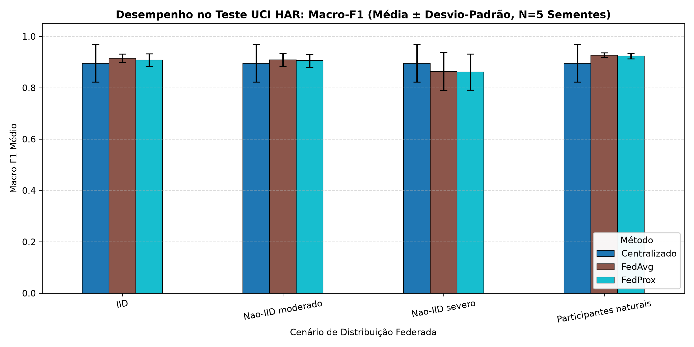
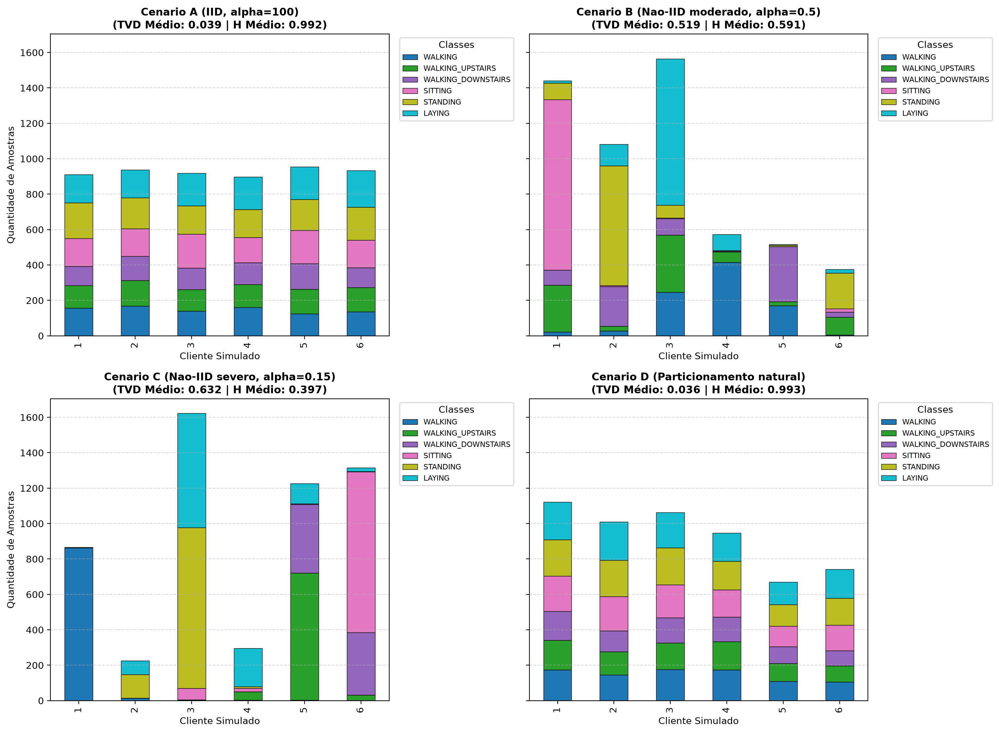
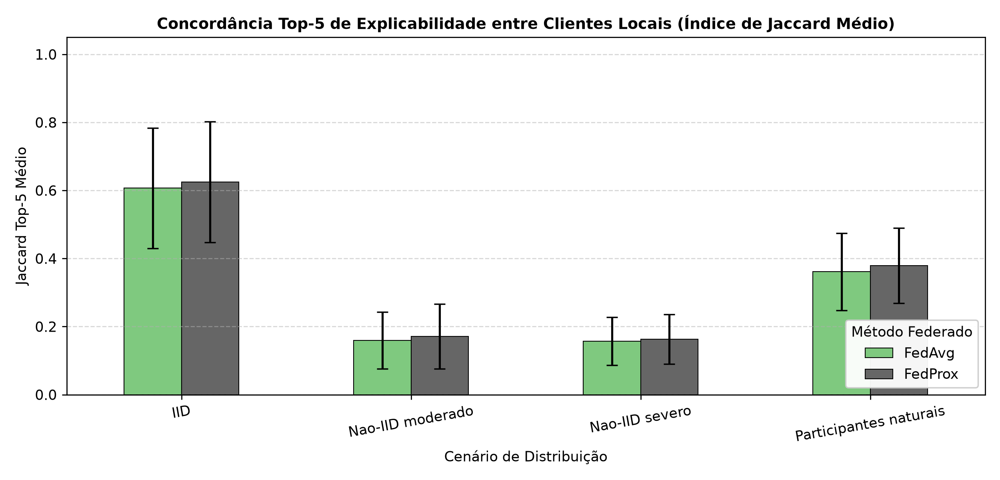
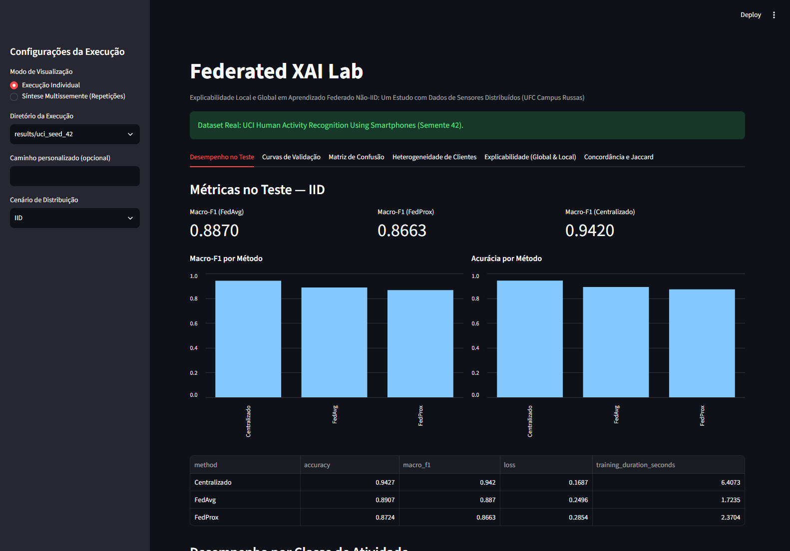
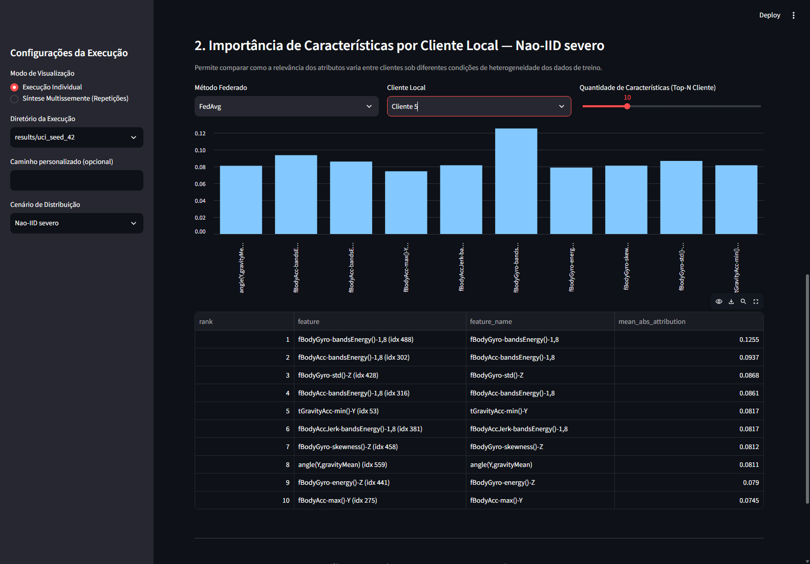
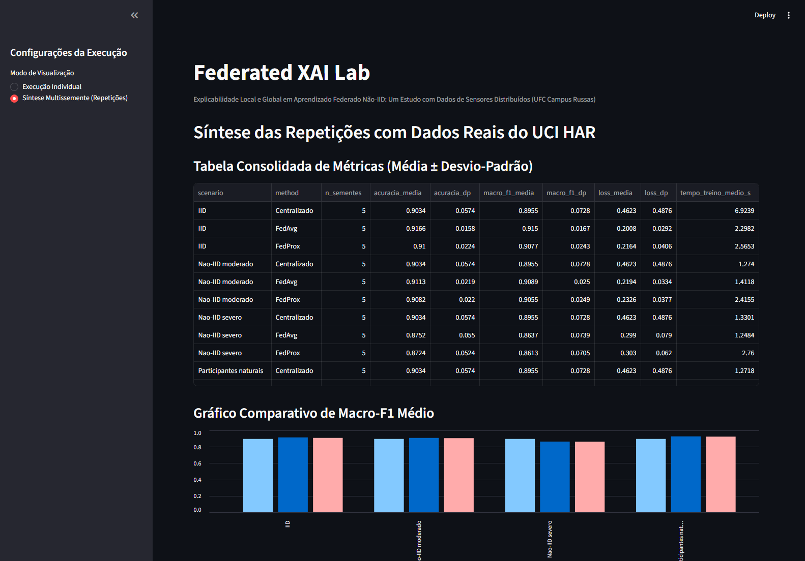

# Federated XAI Lab

> **Aprendizado Federado Não-IID (FedAvg vs. FedProx) e Inteligência Artificial Explicável (Integrated Gradients) sobre dados reais de sensores vestíveis (UCI HAR), com pipeline experimental reproduzível em PyTorch, validação estatística multissemente e dashboard interativo em Streamlit.**

[](https://www.python.org/)
[](https://pytorch.org/)
[](https://streamlit.io/)
[](tests/)
[-005571)](docs/DATASET.md)
[](LICENSE)

**Trabalho Científico:** *Explicabilidade Local e Global em Aprendizado Federado Não-IID: Um Estudo com Dados de Sensores Distribuídos* ([Artigo Completo `.docx`](Artigo_Cientifico_Federated_XAI_Lab_Lucas_Almeida.docx))  
**Instituição:** Universidade Federal do Ceará — Campus Russas (Engenharia de Software)  
**Autor:** Lucas de Souza Almeida (569990)  
**Docente Responsável:** Pitágoras Graça Martins  

---

## 1. Visão Geral e Stack Tecnológica

O **Federated XAI Lab** é um ambiente de pesquisa experimental e engenharia de software reprodutível desenvolvido para investigar os impactos da heterogeneidade estatística (distribuições IID vs. Não-IID) sobre o **desempenho preditivo** e a **explicabilidade local e global de modelos federados** utilizando o método axiomático **Integrated Gradients** (Sundararajan et al., 2017).

O projeto avalia e compara três estratégias de aprendizado:
1. **Treinamento Centralizado:** Modelo de referência treinado sobre todos os dados de treinamento agregados.
2. **FedAvg (Federated Averaging):** Agregação ponderada por tamanho amostral dos parâmetros locais (McMahan et al., 2017).
3. **FedProx:** Otimização federada com penalização proximal local ($\mu = 0,3$) para conter a divergência de modelos locais em redes heterogêneas (Li et al., 2020).

Os experimentos são conduzidos sobre o dataset real de sensores vestíveis **UCI Human Activity Recognition Using Smartphones** (Anguita et al., 2013), respeitando integralmente a separação de indivíduos: 9 voluntários de teste fixos (2.947 amostras para avaliação final não vista) e particionamento dos 21 voluntários de treinamento em 16 para treino local ($5.603 \pm 37$ amostras) e 5 para validação ($1.749 \pm 37$ amostras) via `GroupShuffleSplit` por semente.

### Tecnologias e Competências Aplicadas

| Domínio | Tecnologias / Ferramentas | Aplicação no Projeto |
| :--- | :--- | :--- |
| **Engenharia de Software & Python** | `Python 3.10+`, `PEP 621`, `CLI`, `Git` | Pacote modular instalável (`flxai`), scripts de automação, auditoria SHA-256 e controle de versão limpo |
| **Deep Learning & Aprendizado Federado** | `PyTorch`, `Autograd`, `MLP` | Implementação própria de **FedAvg**, **FedProx** ($\mu = 0,3$), inicialização controlada e 60 checkpoints `.pt` |
| **IA Explicável (XAI)** | `Integrated Gradients`, `Jaccard Top-K` | Atribuições globais e locais por cliente, controle pela classe verdadeira e validação do Axioma da Completude |
| **Ciência de Dados & Estatística** | `NumPy`, `Pandas`, `scikit-learn`, `SciPy`, `Matplotlib` | Particionamento Dirichlet/Natural sem vazamento de sujeitos, TVD/Entropia, testes $t$ pareados, Wilcoxon e Bonferroni |
| **Aplicação Interativa** | `Streamlit` (`app.py`) | Dashboard exploratório com 6 abas analíticas, inspeção por cliente local e síntese multissemente |
| **Qualidade & Reprodutibilidade** | `pytest` (24 testes automatizados) | Testes unitários, axiomáticos, de não-vazamento entre participantes, parser UCI HAR e integração ponta a ponta |

---

## 2. Estrutura do Repositório

```text
Federated-XAI-Lab/
├── data/
│   └── UCI HAR Dataset/          # Dataset real oficial (7.352 treino, 2.947 teste)
├── src/
│   └── flxai/
│       ├── __init__.py
│       ├── data.py               # Ingestão oficial UCI HAR, particionamentos Dirichlet e Natural
│       ├── models.py             # Arquitetura MLP compartilhada (561 -> 32 -> 16 -> 6)
│       ├── federated.py          # Treinamento FedAvg, FedProx, baseline Centralizado e avaliacao
│       ├── explanation.py        # Integrated Gradients, Jaccard Top-K e analise de rankings
│       └── experiment.py         # Orquestracao, coleta de metricas e exportacao
├── tests/
│       ├── test_core.py                  # Testes unitarios do nucleo (modelos, FedAvg, IG)
│       ├── test_ucihar_io.py             # Testes de parser e layout oficial do UCI HAR
│       ├── test_dataset_real.py          # Testes de integridade e nao-vazamento no UCI HAR real
│       ├── test_partitioning.py          # Testes de disjuncao, integridade e cobertura federada
│       ├── test_xai_axioms.py            # Testes do axioma da completude, amostragem e feature_idx
│       └── test_pipeline_integration.py  # Teste de integracao ponta a ponta do pipeline CLI
├── scripts/
│       ├── analisar_cenarios.py           # Analise estatistica e visual da heterogeneidade (TVD, Entropia)
│       ├── analisar_experimentos_reais.py # Consolidacao multissemente e testes pareados
│       ├── recalcular_xai_checkpoints.py  # Recalculo de XAI controlado sobre os 60 checkpoints
│       ├── analisar_estabilidade_ig.py    # Estabilidade dos rankings Top-5 (16/32/64 passos)
│       ├── download_ucihar.py             # Download do UCI HAR com verificacao SHA-256 / estrutural
│       ├── gerar_entregavel_zip.py        # Geracao reprodutivel do pacote ZIP entregavel
│       ├── publicar_federated_xai_github.py # Publicacao validada no GitHub
│       ├── organizar_federated_xai.py     # Limpeza controlada com backup e SHA-256
│       └── consolidar_execucoes.py
├── results/
│       ├── uci_seed_42/                   # Execucao completa semente 42 (checkpoints, XAI, metricas)
│       ├── uci_seed_43/                   # Execucao completa semente 43
│       ├── uci_seed_44/                   # Execucao completa semente 44
│       ├── uci_seed_45/                   # Execucao completa semente 45
│       ├── uci_seed_46/                   # Execucao completa semente 46
│       ├── resumo_experimentos_reais.csv  # Medias e desvios-padrao consolidados (N=5)
│       ├── resumo_concordancia_top5_real.csv # Concordancia Top-5 (classe prevista e controlada)
│       ├── resumo_concordancia_entre_clientes_real.csv # Jaccard inter-clientes
│       ├── teste_estatistico_pareado.json # Testes t pareados e Wilcoxon
│       ├── estabilidade_ig_passos.csv     # 180 comparacoes de estabilidade (com coluna duplicate_reference)
│       ├── resumo_estabilidade_ig_passos.csv # Estabilidade por cenario e metodo
│       ├── resumo_estabilidade_ig_global.csv # Indicadores globais (180 vs 135 comparacoes)
│       └── fig_resumo_macro_f1_real.png   # Grafico publicavel com barras de erro
├── docs/
│       ├── assets/                        # Capturas reais do dashboard interativo Streamlit
│       ├── RELATORIO_AUDITORIA.md         # Relatorio formal de auditoria
│       ├── DATASET.md                     # Documentacao detalhada e proveniencia do dataset
│       └── RELATORIO_EXPERIMENTAL_UCI_HAR.md  # Relatorio cientifico completo
├── Artigo_Cientifico_Federated_XAI_Lab_Lucas_Almeida.docx # Artigo cientifico completo (UCI HAR, 5 sementes)
├── app.py                                 # Dashboard cientifico interativo em Streamlit
├── requirements.txt                       # Dependencias de producao
├── pyproject.toml                         # Metadados e build do pacote
├── LICENSE                                # Licenca MIT oficial
└── README.md
```

---

## 3. Instalação e Configuração

Requer **Python 3.10 ou superior**.

```bash
# 1. Clonar o repositório e entrar no diretório
git clone https://github.com/Lucas-715/Federated-XAI-Lab.git
cd Federated-XAI-Lab

# 2. Criar e ativar o ambiente virtual
python -m venv .venv
# Windows:
.venv\Scripts\activate
# Linux/macOS:
source .venv/bin/activate

# 3. Instalar dependências (inclui pytest) e pacote em modo editável
pip install -r requirements.txt
pip install -e .

# 4. Obter o dataset oficial UCI HAR (não incluído no ZIP por restrição de tamanho):
python scripts/download_ucihar.py
# (O script baixa e descompacta os dados em data/UCI HAR Dataset.)
# Dois níveis de verificação:
#   - Download: compara o SHA-256 do ZIP interno com o hash configurado no script.
#     Esse hash foi observado no arquivo obtido pelo autor e NÃO foi confirmado
#     em uma referência externa independente.
#   - Dados já extraídos: apenas verificação ESTRUTURAL (8 arquivos essenciais e
#     tamanho mínimo), sem verificação criptográfica.
# Use `python scripts/download_ucihar.py --strict` para exigir a verificação SHA-256.
```

---

## 4. Reprodução dos Experimentos Reais (UCI HAR)

Para reproduzir os experimentos com o dataset oficial da UCI nas 5 sementes independentes (42 a 46):

```bash
# Semente 42 (120 amostras estratificadas: 20 por classe, cobrindo todos os 9 sujeitos de teste)
python -m flxai.experiment --mode uci --dataset-path "data/UCI HAR Dataset" --output-dir results/uci_seed_42 --rounds 15 --clients 6 --lr 0.07 --mu 0.3 --xai-samples 120 --ig-steps 16 --client-xai-samples 25 --client-ig-steps 12 --include-natural --seed 42

# Sementes 43 a 46 seguem a mesma sintaxe com --seed correspondente.
```

### Recalcular XAI sobre Checkpoints Existentes
Para recalcular Integrated Gradients diretamente sobre os 60 checkpoints `.pt` salvos (avaliando tanto classe prevista quanto classe verdadeira controlada):

```bash
python scripts/recalcular_xai_checkpoints.py
```

### Consolidação Estatística Multissemente
Execute o script de consolidação para gerar as tabelas de resumo, testes pareados e figuras com barras de erro:

```bash
python scripts/analisar_experimentos_reais.py
```

---

## 5. Resultados Científicos Consolidados ($N = 5$ Sementes)

### Desempenho no Teste Oficial (Indivíduos Não Vistos)

| Cenário de Distribuição | Centralizado (Macro-F1) | FedAvg (Macro-F1) | FedProx (Macro-F1) | FedProx vs FedAvg ($p$-valor $t$-pareado) |
|:---|:---:|:---:|:---:|:---:|
| **IID ($\alpha = 100$)** | 0,8955 $\pm$ 0,0728 | **0,9150 $\pm$ 0,0167** | 0,9077 $\pm$ 0,0243 | $p = 0,122$ (Não significativo) |
| **Não-IID moderado ($\alpha = 0,5$)** | 0,8955 $\pm$ 0,0728 | **0,9089 $\pm$ 0,0250** | 0,9055 $\pm$ 0,0249 | $p = 0,248$ (Não significativo) |
| **Não-IID severo ($\alpha = 0,15$)** | **0,8955 $\pm$ 0,0728** | 0,8637 $\pm$ 0,0739 | 0,8613 $\pm$ 0,0705 | $p = 0,486$ (Não significativo) |
| **Participantes naturais** | 0,8955 $\pm$ 0,0728 | **0,9270 $\pm$ 0,0089** | 0,9233 $\pm$ 0,0109 | $p_t = 0,018$ (Tendência empírica; não-sig. pós-Bonferroni $\alpha_{corr}=0,0125$) |



### Visualização da Heterogeneidade e da Concordância de Explicações

| Heterogeneidade Estatística dos 4 Cenários (TVD e Entropia) | Concordância Top-5 de Explicabilidade entre Clientes Locais |
| :---: | :---: |
|  |  |

### Síntese de Explicabilidade (Integrated Gradients)
- **Amostragem Estratificada Rigorosa:** 120 instâncias de teste selecionadas exatamente com 20 amostras por classe de atividade (Walking, Walking Upstairs, Walking Downstairs, Sitting, Standing, Laying), com todos os 9 sujeitos de teste representados (`amostragem_xai.json`).
- **Concordância Top-5 Controlada pela Classe Verdadeira:**
  - FedProx vs. FedAvg: Jaccard Top-5 de **$0,933$ em IID**, **$1,000$ em Não-IID Moderado**, **$0,867$ em Não-IID Severo** e **$0,933$ em Natural**.
  - FedAvg vs. Centralizado: Jaccard Top-5 de **$0,689 \pm 0,363$ em IID**, **$0,463 \pm 0,380$ em Moderado**, **$0,425 \pm 0,248$ em Severo** e **$0,752 \pm 0,246$ em Natural**.
  - O controle da classe verdadeira revelou que divergências de classificação em instâncias limítrofes constituíam um fator de confusão relevante nas comparações puramente descritivas, embora coexistam com variações estocásticas nas representações dos modelos.
- **Desambiguação de Atributos:** Todas as 561 posições de características possuem identificadores posicionalmente únicos (`idx 0` a `idx 560`), eliminando qualquer risco de colisão entre os 42 nomes triplicados do UCI HAR (como `tGravityAcc-energy()-X`, identificado exclusivamente como `idx 56`).
- **Concordância Inter-Clientes (Dados Locais de Treino):** Em cenário IID, a concordância média entre pares de clientes locais foi de **0,607 $\pm$ 0,177**. Sob heterogeneidade, a concordância média recua para **0,159 $\pm$ 0,084** (Moderado) e **0,157 $\pm$ 0,070** (Severo), refletindo empiricamente a especialização dos dados de treino em subconjuntos restritos de classes combinada com a forte assimetria no volume amostral entre clientes no particionamento Dirichlet severo (e.g. de 11 a 2.572 amostras na semente 43, onde a amostragem de até 25 instâncias locais amplia a variância nos clientes menores).
- **Validação Axiomática Multi-Passo:** Verificação quantitativa do Axioma da Completude ($\sum IG_i \approx F(x) - F(0)$) avaliando o conjunto completo das 120 amostras de teste estratificadas (todas as 6 classes de atividade representadas). O erro relativo médio de completude situou-se confortavelmente abaixo de 1% em todas as cinco sementes já a partir de 16 passos (média geral de **0,557%** a 16 passos, **0,382%** a 32 passos e **0,238%** a 64 passos, com 100% das sementes mantendo média abaixo do limiar de 1% em todas as escalas avaliadas). O limiar aplica-se à média amostral, ocorrendo flutuações locais em instâncias isoladas limítrofes devido a descontinuidades de derivada em redes ReLU.
- **Estabilidade dos Rankings Top-5:** Nas configurações avaliadas (16, 32 e 64 passos, 120 amostras estratificadas), os rankings Top-5 foram **altamente estáveis**, mas não invariantes. Os 60 arquivos de checkpoint correspondem a **45 conjuntos distintos de parâmetros** (os quatro `*_centralizado.pt` de cada semente são idênticos). Com todos os arquivos, foram 180 comparações: Jaccard médio $0,9963 \pm 0,0350$, conjunto idêntico em 178/180 e ordem idêntica em 176/180. Sem as duplicações do baseline centralizado, são 135 comparações: Jaccard médio $0,9951$, conjunto idêntico em 133/135 e ordem idêntica em 131/135. As quatro divergências ocorrem no cenário Participantes naturais (semente 44, FedAvg: ordem diferente com mesmo conjunto; semente 45, FedProx: Jaccard 0,667). As comparações reutilizam modelos, sementes e amostras e **não são experimentos estatisticamente independentes**. Detalhes em `results/estabilidade_ig_passos.csv` e `results/resumo_estabilidade_ig_global.csv` (gerados por `python scripts/analisar_estabilidade_ig.py`).

---

## 6. Dashboard Interativo (Streamlit)

O dashboard interativo (`app.py`) permite inspecionar cada execução sem recalcular modelos, examinar matrizes de confusão, curvas de validação de perda/Macro-F1, distribuições de classes por cliente, atribuições globais e locais via Integrated Gradients e a síntese multissemente com testes estatísticos.

```bash
streamlit run app.py
```

### Prévia da Interface (Dados Reais do UCI HAR)

#### 1. Comparação de Desempenho dos Modelos no Teste (Centralizado, FedAvg e FedProx)


#### 2. Explicabilidade por Cliente Local (Integrated Gradients sob Cenário Não-IID Severo)


#### 3. Síntese Multissemente Consolidada ($N = 5$ Sementes Reais)


---

## 7. Testes Automatizados

O repositório possui suite completa de 24 testes automatizados (testes unitários, axiomáticos, de particionamento, de conformidade do UCI HAR e teste de integração ponta a ponta do pipeline). Na ausência do dataset bruto no diretório local, os testes que dependem do arquivo bruto efetuam `skip` gracioso.

```bash
pytest -v tests
```
Saída esperada:
```text
============================== 24 passed in ~30s ==============================
```

---

## 8. Tópicos, Licença e Créditos

**Tópicos do Projeto:** `python` · `pytorch` · `federated-learning` · `explainable-ai` · `integrated-gradients` · `non-iid` · `machine-learning` · `streamlit` · `uci-har` · `sensor-data` · `software-engineering`

Este projeto é disponibilizado sob a [Licença MIT](LICENSE).  
A base **UCI Human Activity Recognition Using Smartphones** é de domínio público acadêmico disponibilizada pela Universidade da Califórnia, Irvine (UCI) e Autores (Anguita et al., 2013).
